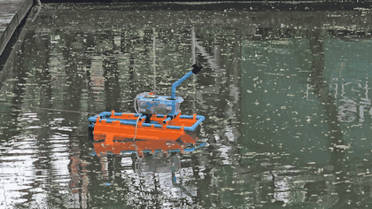
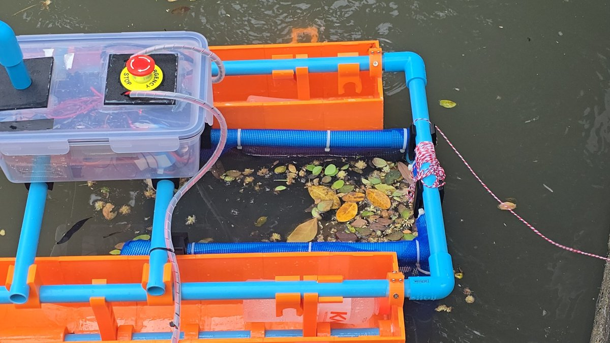
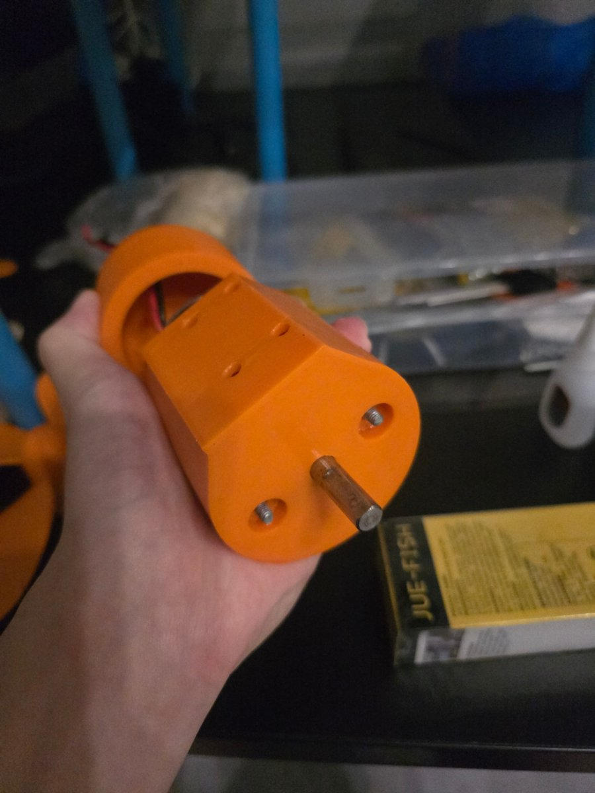
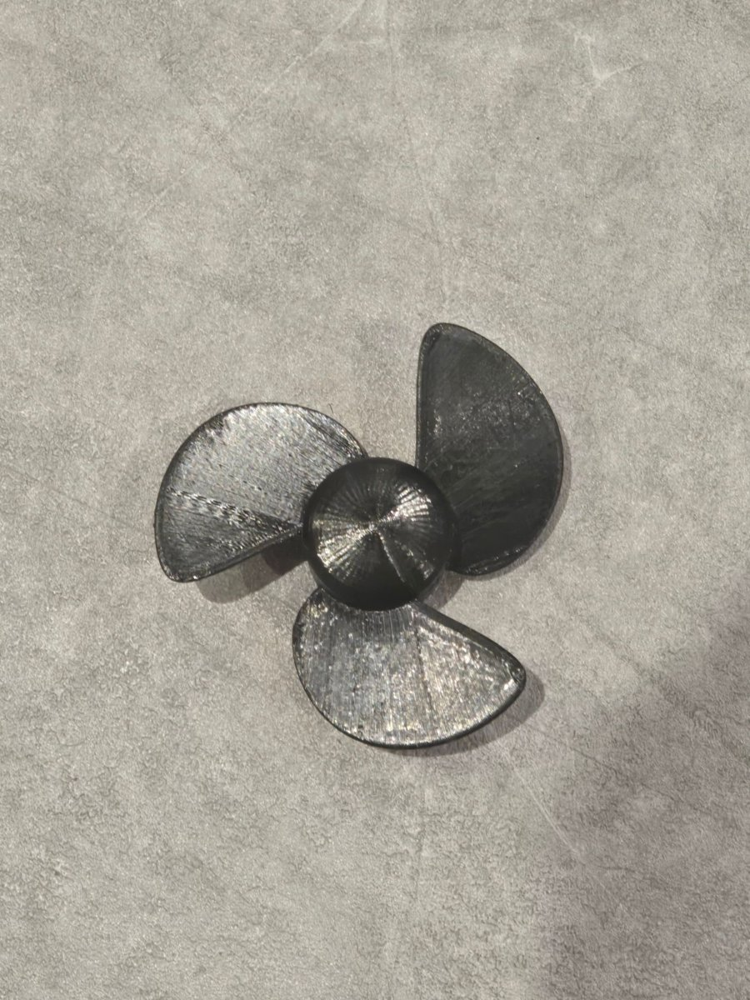
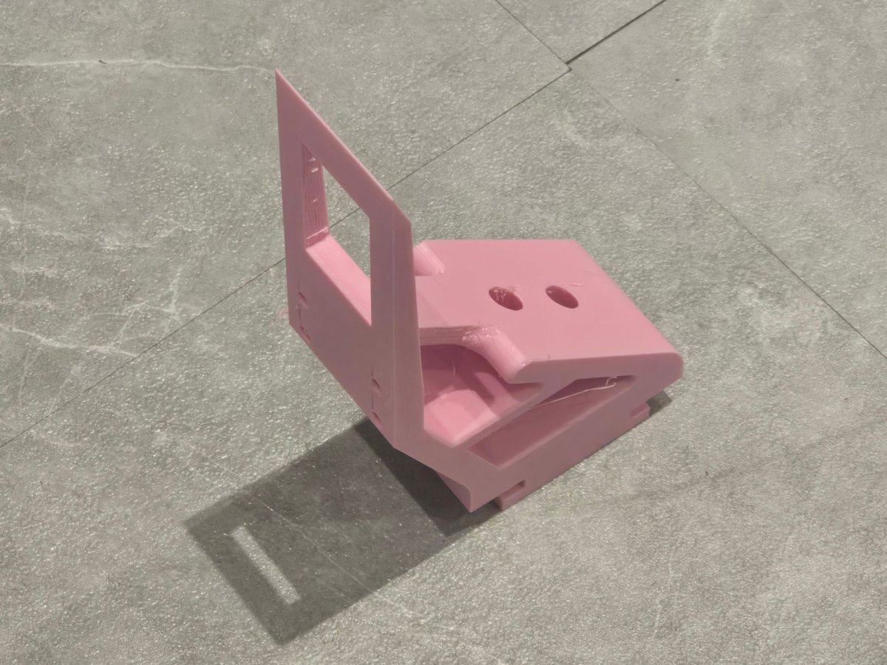

# Autonomous Leaf-Collecting Raft

Autonomous catamaran that collects floating leaves from a canal, using camera-based detection and PID motor control.

| | |
|---|---|
| **Course** | Feedback Control (01416304), KMITL |
| **Date** | November 2025 |
| **Team** | 10 members (circuit, hardware, software and mathematics sub-teams) |
| **My role** | Hardware team (3 members): fabrication, waterproofing and assembly |

## Overview

The raft carries a camera, a control box and a collection net between two hulls. Floating leaves are detected by a YOLO model running on a Raspberry Pi, and the propeller motors are driven through an analog PID controller.

## My contribution

- **Fabrication:** 3D-printed all structural parts (hull modules, motor casings, mounts and propellers) from CAD models designed by a teammate.
- **Waterproofing:** sanded the parts for adhesion, applied a two-part epoxy coating and sealed the joints with silicone so that the raft remained watertight.
- **Assembly:** assembled the complete raft (675 × 500 × 150 mm, approximately 7 kg).
- Assisted with breadboard wiring for the first PID test.

The vision model, the PID circuit and the control software were developed by other members of the team.

## Photos

| Collecting leaves | Motor casing |
|---|---|
|  |  |

| Propeller | Motor mount |
|---|---|
|  |  |

**Skills applied:** FDM 3D printing, surface preparation, epoxy coating, waterproof sealing, mechanical assembly
