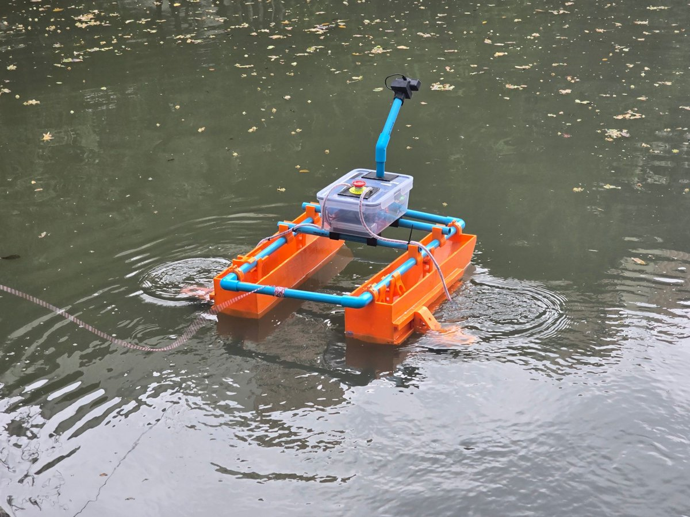

# Autonomous Leaf-Collecting Raft

A small catamaran raft that collects floating leaves from a canal. It used a camera (YOLO on a Raspberry Pi) and PID-controlled propellers.

Feedback Control course, KMITL, November 2025. Team of 10, split into circuit, hardware, software and maths sub-teams.

## My part (hardware team, 3 of 10)
- **3D-printed every part** (hull modules, motor casings, mounts, propeller), from CAD made by a teammate.
- **Sanded** the parts for adhesion, **epoxy-coated** them and **sealed** them with silicone so the raft stayed watertight.
- **Assembled** the full raft (675 x 500 x 150 mm, about 7 kg).
- Helped with breadboard wiring for the first PID test.

The vision model, the PID circuit and the software were built by other members of the team.

| On the water | Collecting leaves |
|---|---|
|  |  |

| Motor casing | Propeller | Motor mount |
|---|---|---|
|  |  |  |
