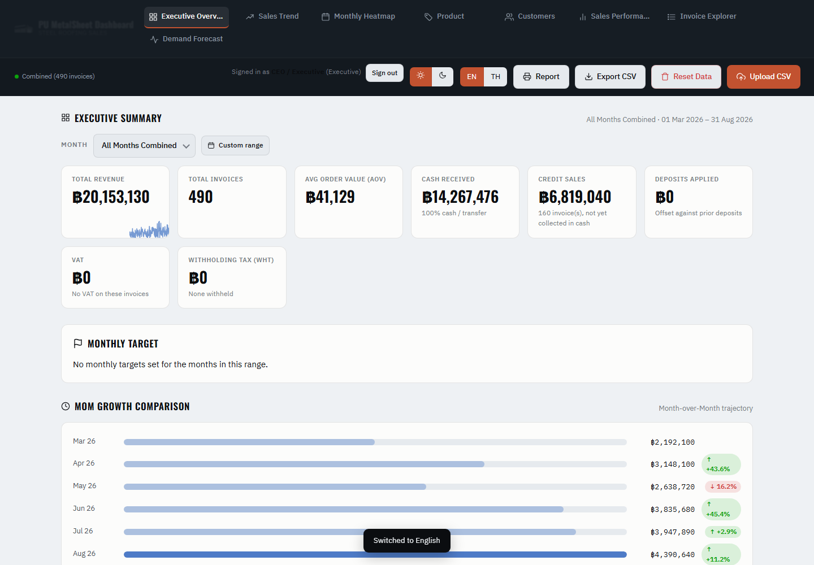
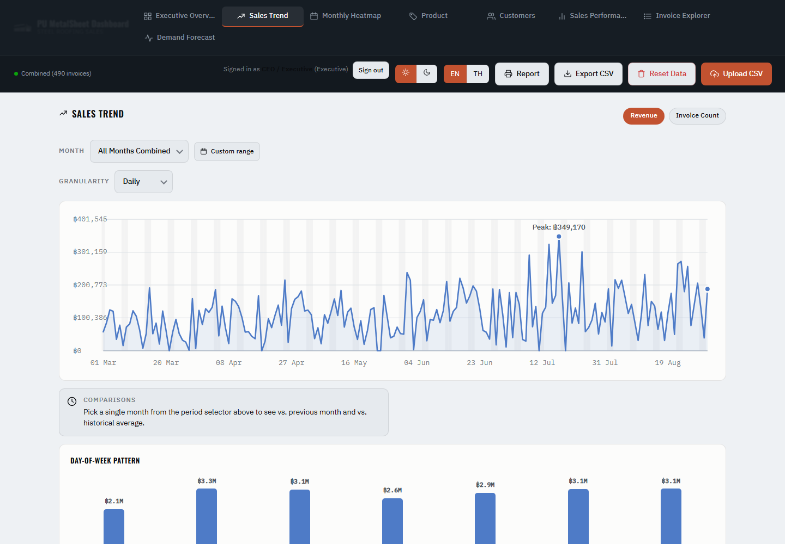
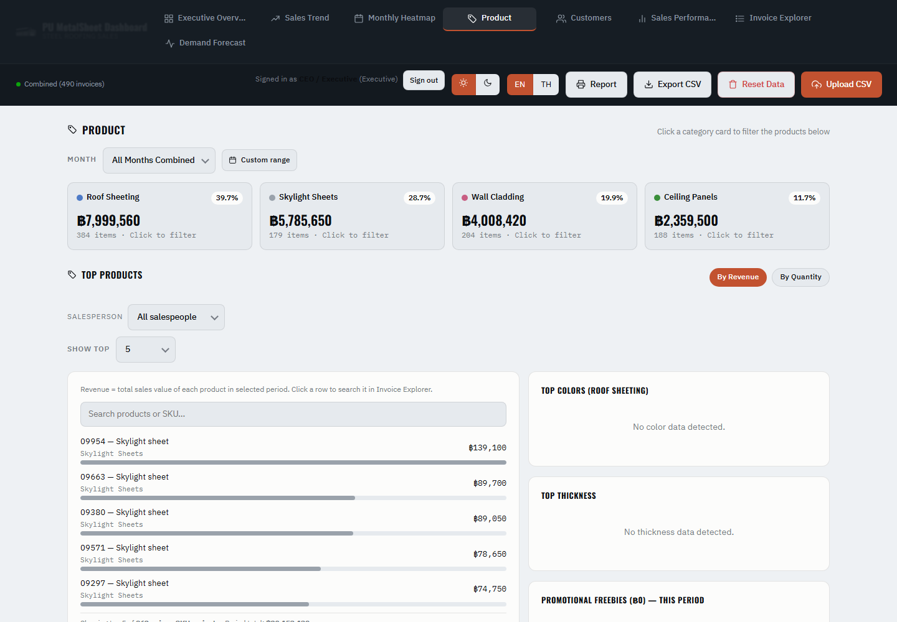
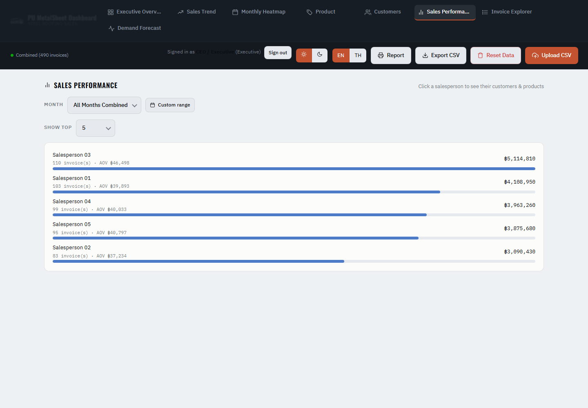

# Metal-Roof Sales Dashboard (PU MetalSheet)

A one-file sales dashboard for a real metal-roofing company. It replaced the text-only reports from the company's accounting software (Express).
A professor brought in the company's CEO, and every student built their own version. **This is mine.**

- Open `MetalSheetDashboardPOC.html` in a browser and upload the CSV exports (cash sales, credit sales, deposits). It works out which file is which by itself.
- Everything runs in the browser, so the data never leaves the computer.
- Role-based views: executive, manager, and sales (each salesperson sees only their own numbers).
- Monthly targets, month-on-month growth, sales breakdowns and a forecast page. English and Thai.

The company's data is confidential and is **not** included. The demo logins are written in the page itself, because this is a proof of concept, not a secure system.

## Try it
Open the HTML file, upload `sample_data/FAKE_demo_sales.csv` (490 invented invoices, March to August 2026), and log in as `ceo` / `ceo123`.

## Screenshots (fake data)
| Executive overview | Sales trend |
|---|---|
|  |  |

| Products | Sales performance |
|---|---|
|  |  |
