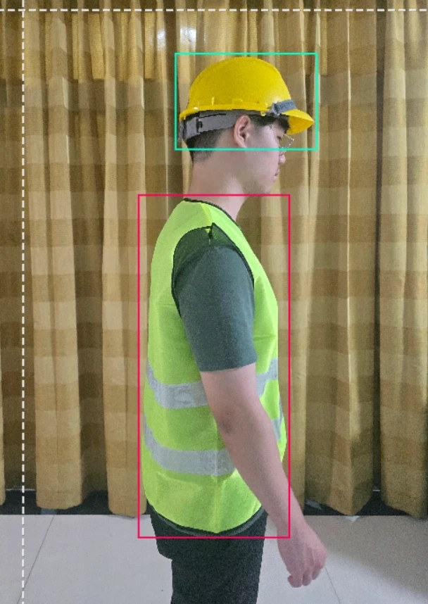
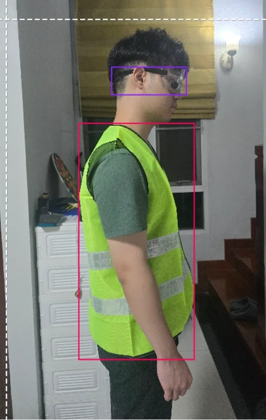
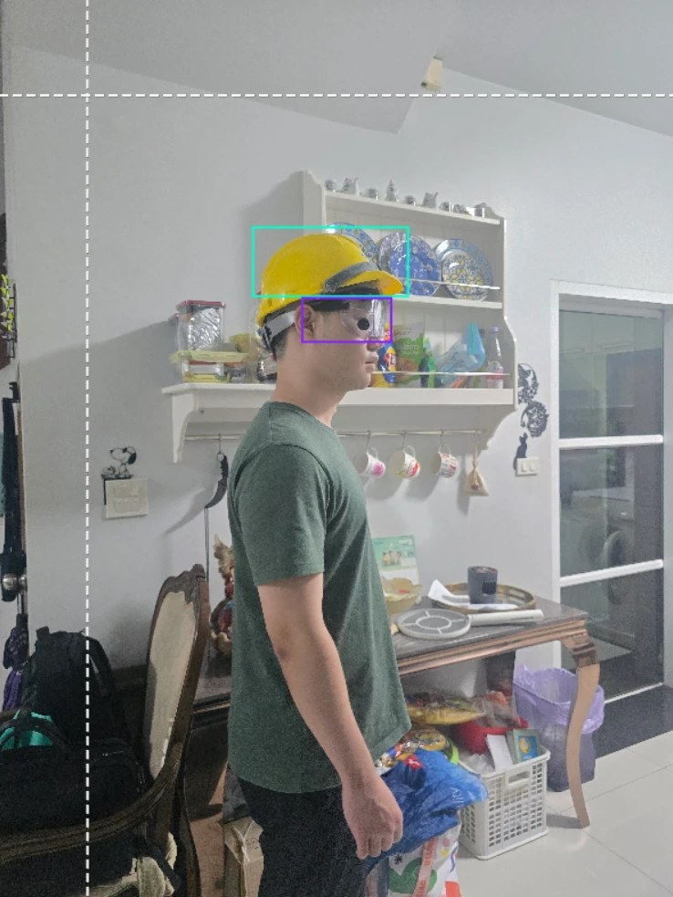
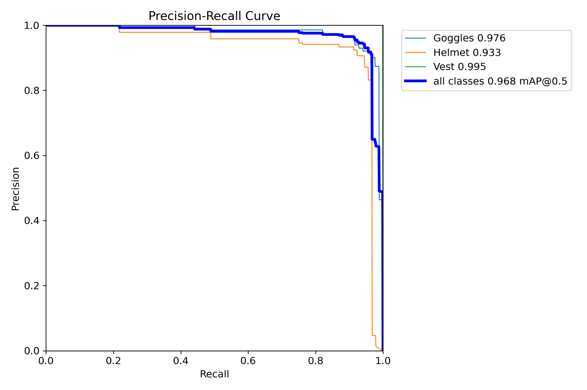
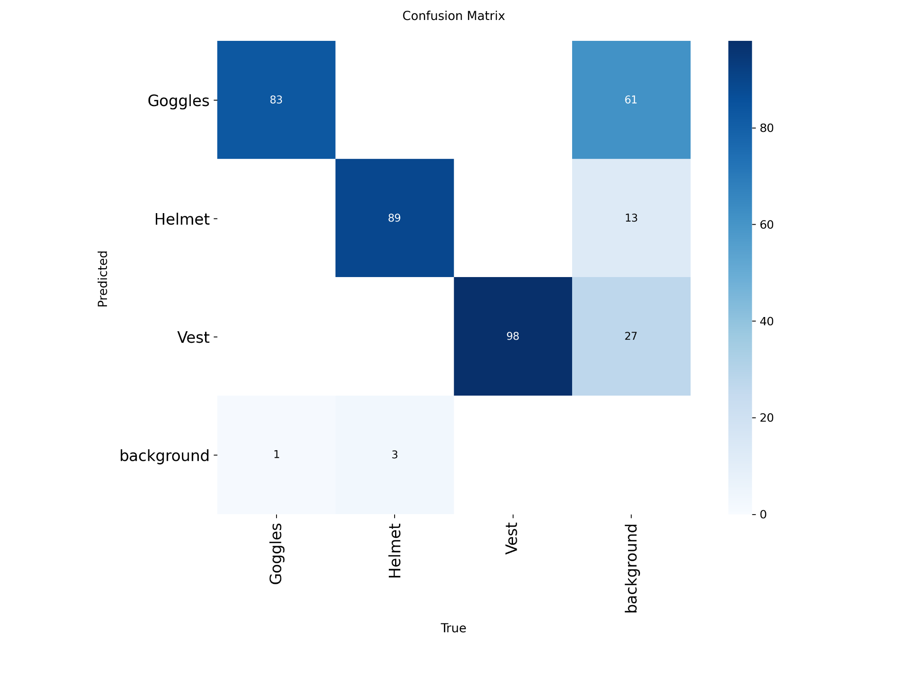

# PPE Detection System

Checks in real time whether a worker is wearing a **helmet, safety vest and goggles**. If anything is missing, the screen shows `WARNING - Missing: <item>` and an alarm plays. When everything is detected, it shows `PASS`.

Robotics Laboratory 3, KMITL, 2026. Team of 6. **I led the project and did about 70% of the work.**

## What I did
- Planned the project and made the key technical decisions.
- Captured the first part of the dataset and used it as the collection guide for the team.
- Annotated the images in Roboflow and trained the model (first on Colab, then locally).
- Deployed it on a Jetson Nano with a webcam, and presented the live demo.

## How it works
1. A YOLO11 model (Ultralytics) detects `Helmet`, `Vest` and `Goggles` in each webcam frame (confidence threshold 0.3).
2. The detected classes are compared with the required list.
3. The result is PASS or WARNING, naming exactly what is missing. The laptop version also plays a looping alarm until the issue is fixed.

The same `safety.py` runs on the laptop and on the Jetson Nano.

## Dataset
- 750 original photos (our own captures plus Roboflow), 3 classes, resized to 640x640.
- The training set was augmented 3x (flip, rotation ±15°, shear ±15°), giving 1,800 images in total: 1,575 train, 150 validation, 75 test.

| Annotated samples | | |
|---|---|---|
|  |  |  |

## Results (150-image validation set)

| Class | Precision | Recall | mAP@50 | mAP@50-95 |
|---|---|---|---|---|
| All | 0.915 | 0.949 | 0.968 | 0.607 |
| Goggles | 0.872 | 0.976 | 0.976 | 0.529 |
| Helmet | 0.935 | 0.870 | 0.933 | 0.492 |
| Vest | 0.937 | 1.000 | 0.995 | 0.799 |




On the Jetson Nano it runs at about 6 to 9 FPS with plain PyTorch (no TensorRT yet).
The model was also tested live on a person who was not in the dataset.

## What I learned / next steps
- Goggles were the hardest class: they are small and transparent, so their boxes were the least precise (mAP@50-95 0.529).
- Background false positives were the main error, so more negative images would help.
- Next step: export to TensorRT (FP16) to raise the FPS on the Jetson.

## Run it
```bash
pip install -r requirements.txt
python safety.py   # press q to quit
```
`model/best.pt` holds the trained weights. The dataset is on Roboflow (see `training/data.yaml`).
