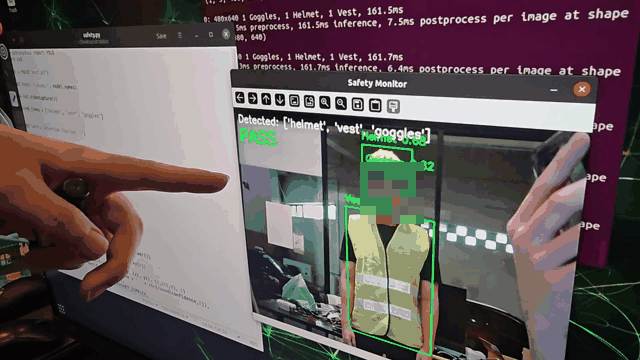

# PPE Detection System

Real-time detection of personal protective equipment (helmet, high-visibility vest and safety goggles) on an NVIDIA Jetson Nano.

| | |
|---|---|
| **Course** | Robotics Laboratory 3 (01416516), KMITL |
| **Date** | February – March 2026 |
| **Team** | 6 members |
| **My role** | Project lead; approximately 70% of the work |



*Live demonstration on the Jetson Nano. The status changes from `PASS` to `WARNING - Missing: helmet` when the helmet is removed. The teammate's face has been pixelated.*

## Overview

Missing protective equipment is a common cause of preventable workplace injuries. This system checks a camera feed for three required items and reports, frame by frame, whether the worker is compliant. If any item is missing, it names the item on screen and sounds an alarm until the issue is corrected.

## My contribution

- Planned the project and made the main technical decisions.
- Captured the first part of the dataset and used it as the collection guideline for the rest of the team.
- Annotated the dataset in Roboflow and trained the detection model, first on Google Colab and then locally.
- Deployed the system on the Jetson Nano and presented the live demonstration.

## Technical approach

1. **Detection.** An Ultralytics YOLO11 model detects three classes: `Helmet`, `Vest` and `Goggles` (confidence threshold 0.3).
2. **Compliance logic.** The detected classes are compared with the list of required items, and the missing items are identified explicitly.
3. **Output.** The frame shows bounding boxes, confidence scores and a `PASS` or `WARNING - Missing: <item>` status. The laptop version also plays a looping audio alarm.

The same `safety.py` script runs on a laptop and on the Jetson Nano.

### Dataset

- 750 original images (team captures and Roboflow sources), three classes, resized to 640 × 640.
- The training split was augmented three times (horizontal flip, rotation ±15°, shear ±15°), giving 1,800 images: 1,575 training, 150 validation and 75 test.

| Annotated samples | | |
|---|---|---|
|  |  |  |

## Results

Validation set, 150 images:

| Class | Precision | Recall | mAP@50 | mAP@50-95 |
|---|---|---|---|---|
| All | 0.915 | 0.949 | 0.968 | 0.607 |
| Goggles | 0.872 | 0.976 | 0.976 | 0.529 |
| Helmet | 0.935 | 0.870 | 0.933 | 0.492 |
| Vest | 0.937 | 1.000 | 0.995 | 0.799 |


- On the Jetson Nano the system runs at approximately 6–9 frames per second using standard PyTorch inference.
- The model was also tested live on a person who did not appear in the dataset.

## Limitations and next steps

- **Goggles** are the most difficult class because they are small and transparent; their localisation is the least precise (mAP@50-95 0.529).
- Most errors are **background false positives**. Adding more negative images would reduce them.
- Exporting the model to **TensorRT (FP16)** would increase the frame rate on the Jetson Nano.

## Repository contents

| Path | Description |
|---|---|
| `safety.py` | Detection and compliance application |
| `model/best.pt` | Trained model weights |
| `training/data.yaml` | Dataset configuration (Roboflow export) |
| `alarm.wav` | Alarm sound |
| `media/` | Demonstration, dataset samples and evaluation charts |

## How to run

```bash
pip install -r requirements.txt
python safety.py   # press q to quit
```

**Tech stack:** Python, Ultralytics YOLO11, OpenCV, Roboflow, Pygame, NVIDIA Jetson Nano
