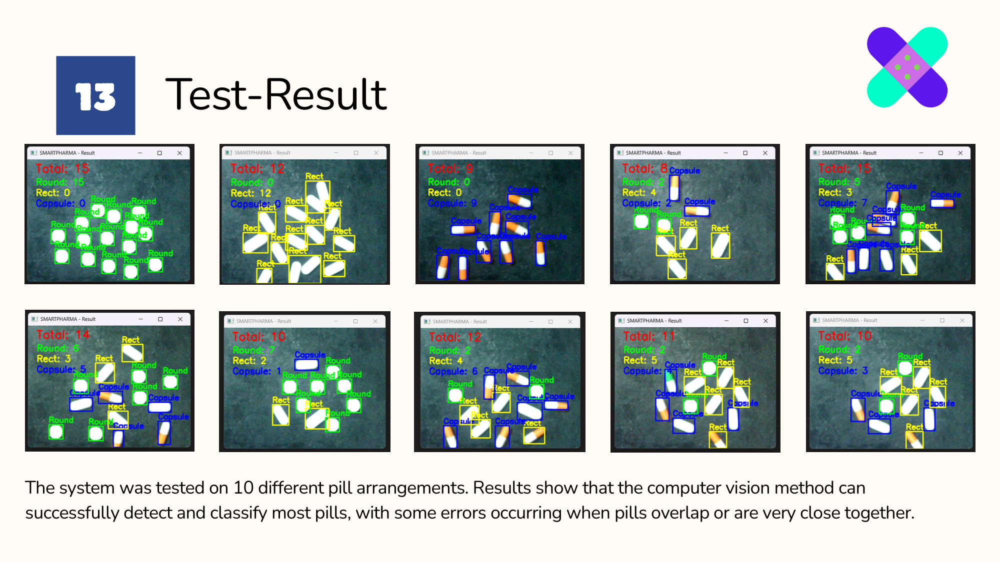
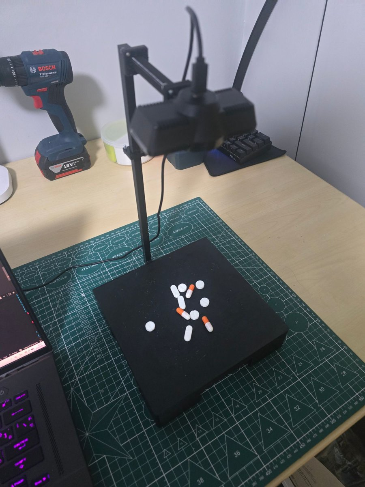
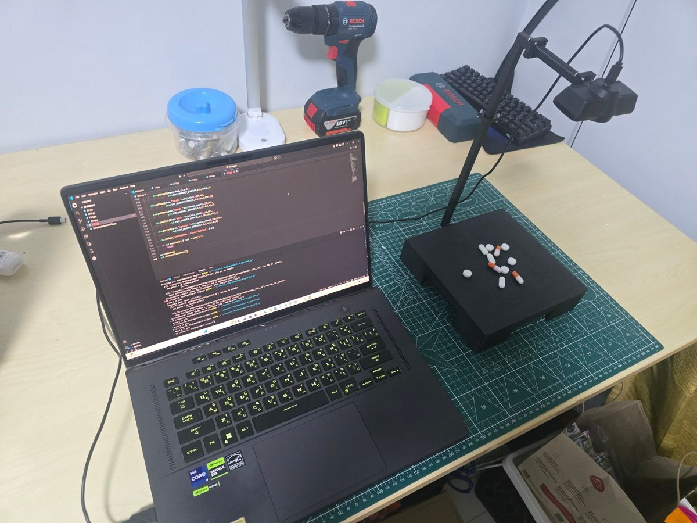

# SmartPharma: Pill Counter

Counting and classification of pills from a webcam image using classical computer vision.

| | |
|---|---|
| **Course** | Computer Vision (01416500), KMITL |
| **Date** | 2026 |
| **Team** | 2 members |
| **My role** | Vision code; design and fabrication of the camera rig |

## Overview

Manual pill counting is slow and error-prone. This system captures an image of pills on a fixed background, counts them and sorts them into three categories: round tablets, rectangular tablets and capsules. Because the lighting and background are controlled, classical image processing is sufficient and no training data is required.

## My contribution

- Developed and debugged the vision code, starting from an AI-generated first draft.
- Designed the camera rig in Fusion 360 and 3D-printed it: a 20 × 20 cm black base for contrast and an arm that holds the camera 30 cm above the centre. The base is flat so that it prints without support material.

## Technical approach (`pill_counter.py`)

1. **Capture:** live webcam preview; press SPACE to capture and Q to quit.
2. **Segmentation:** grayscale conversion, Gaussian blur and Otsu thresholding to separate the pills from the background.
3. **Clean-up:** morphological opening removes noise; a distance transform helps to separate pills that touch.
4. **Classification:** area, aspect ratio and circularity identify round tablets; HSV colour features distinguish capsules from rectangular tablets.
5. **Output:** labelled bounding boxes, the total count and the count per category.

| Camera rig | Setup |
|---|---|
|  |  |

## Results

The system was tested on ten different arrangements and classified most pills correctly. Errors occurred when pills touched or overlapped.

## Limitations and next steps

- Rule-based features cannot separate pills of similar shape or pills that are stacked.
- A trained object detector (for example YOLO), combined with a vibrating tray that spreads the pills into a single layer, would address both issues.

**Tech stack:** Python, OpenCV, NumPy, Fusion 360, 3D printing
