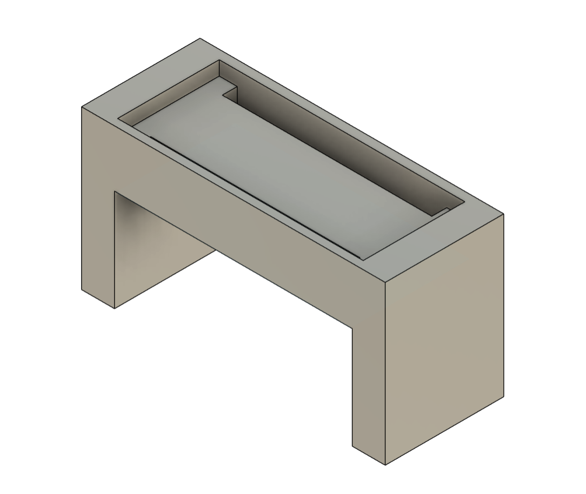
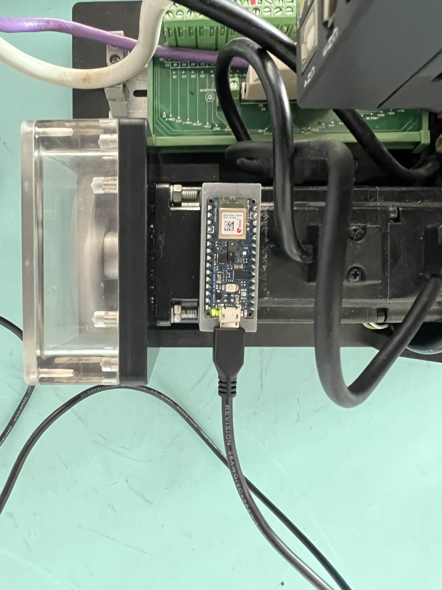

# TinyML Machine-Speed Classifier

Recognises how fast a machine's motor is running (**idle, 14k, 15k or 17k RPM**) from its vibration, entirely on a microcontroller.

Robotics Laboratory 3, KMITL, January 2026. Team of 2.

## How it works
- An **Arduino Nano 33 BLE** fixed to the machine reads its 9-axis IMU (accelerometer, gyroscope, magnetometer) at 100 Hz.
- **Edge Impulse** turns 2-second windows into spectral features and trains a small classifier.
- The model is deployed on the board as **int8**: about 1 ms inference, 1.5 KB RAM and 17.8 KB flash. The predictions were checked live over serial.

It reached 100% on its 80/20 test split. That dataset is small and was recorded under controlled conditions, so treat this as a proof of concept, not a field-ready result.

## The mount (my CAD and print)
To get repeatable readings, the board has to sit in exactly the same place every run. I designed a small U-shaped tray (53.8 x 21 x 28 mm) in Fusion 360 and 3D-printed it in PLA. It holds the board flat on the motor.

| CAD | Printed and mounted |
|---|---|
|  |  |

## Why it matters
This is the basic idea behind condition monitoring and predictive maintenance: tell what a machine is doing from its vibration, cheaply, on the device itself.
