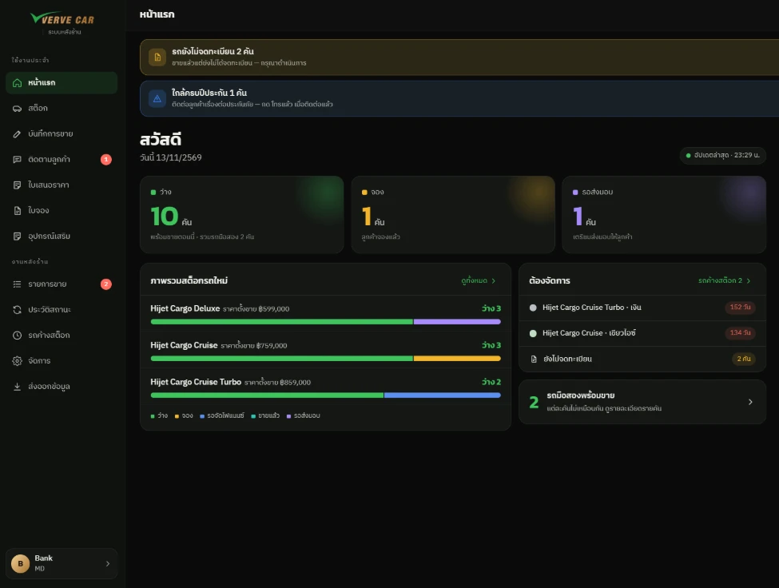
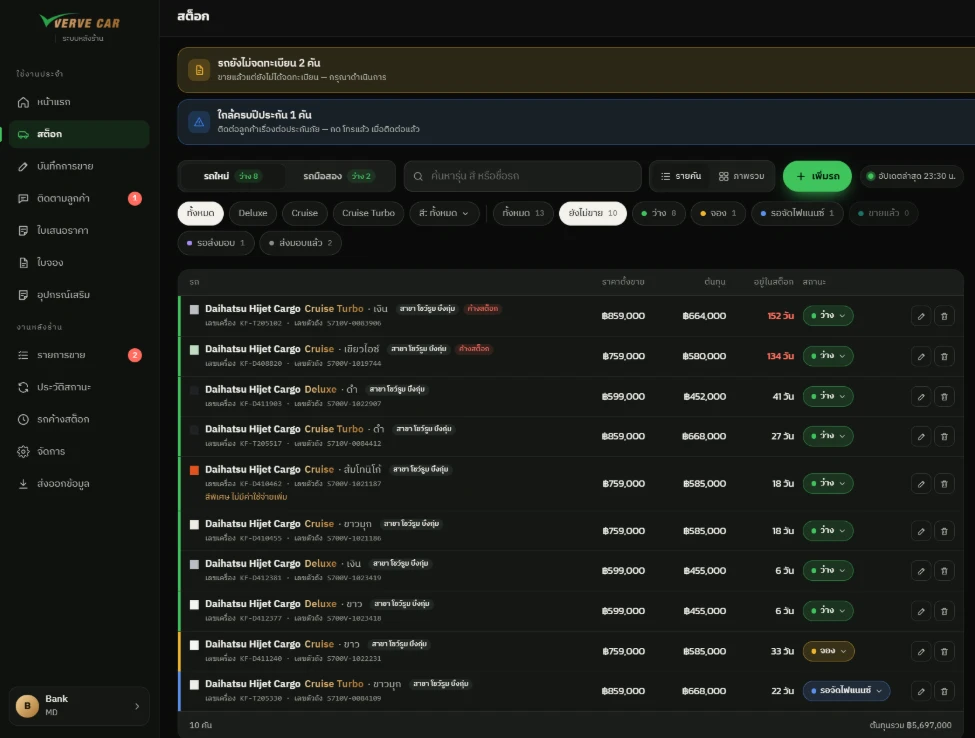
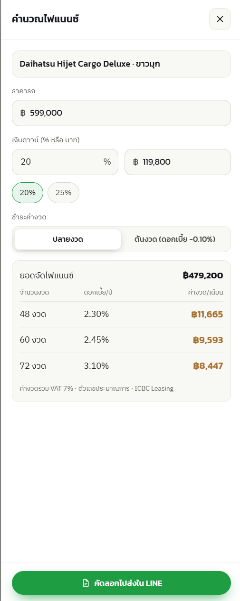
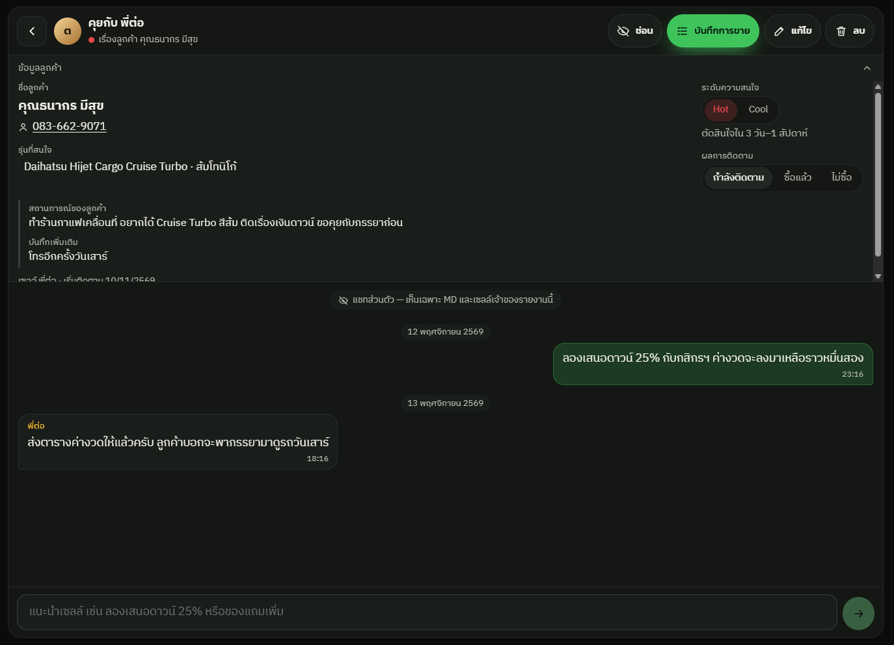
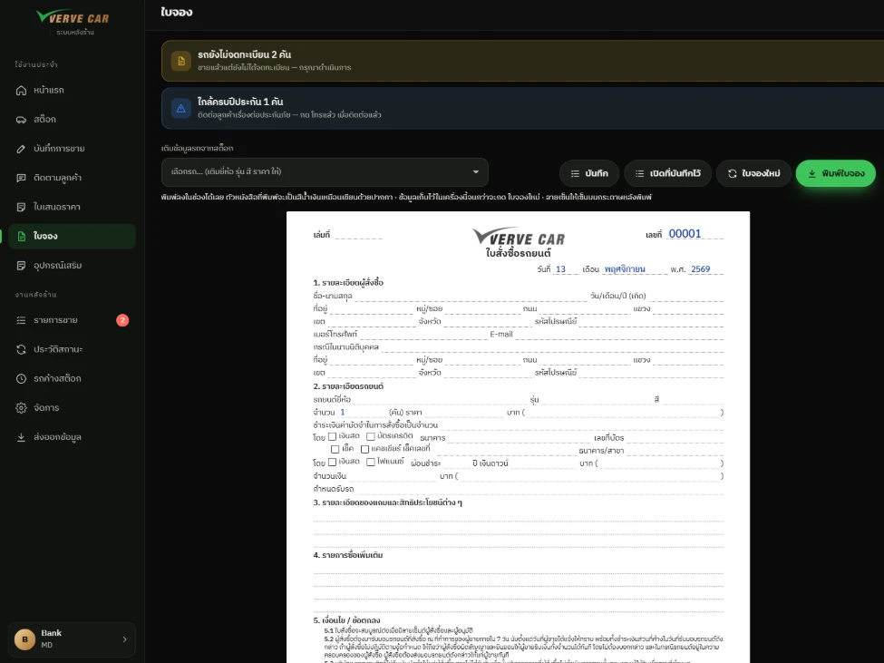
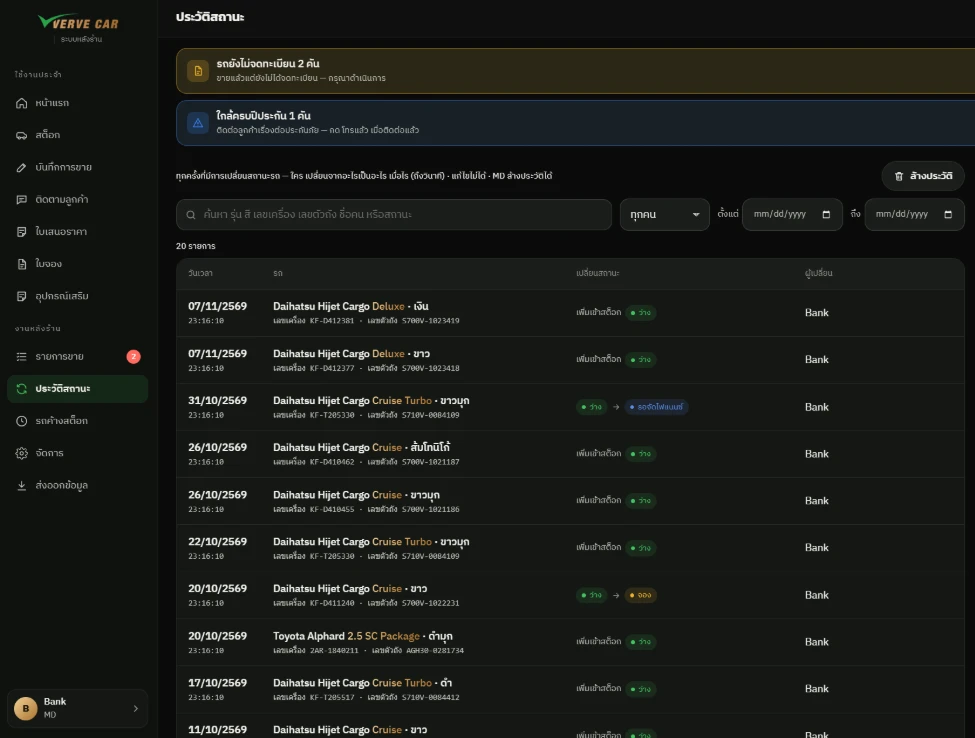

# VerveCar Back Office (AutoDeal IQ)

A live back-office web app for **VerveCar**, a Bangkok dealership that imports new Daihatsu Hijet Cargo vans from Japan.
It replaced phone calls, LINE messages and paper forms for stock, sales and documents. The interface is in Thai.

Sep to Oct 2026, team of 2. **I gathered the requirements with the managing director, built the first proof of concept and built most of the app.**
The source code is private (it belongs to the business). All the screenshots below use **demo data**.

**Stack:** React, TypeScript, Vite (installable as a PWA), Supabase (PostgreSQL, Auth, Storage, Edge Functions), Cloudflare.

## Features
- **Stock board:** every car with its status (available, booked, waiting for finance, sold), days in stock, search and filters. Cars in stock over 3 months are flagged.
- **Sales:** the sales team records a sale and the MD reviews it. A sale is approved automatically when the car and commission are filled in. A checklist shows what data is still missing.
- **Finance calculator:** down payment as % or baht, 48/60/72-month instalments from editable bank rate tables (VAT included), and a one-tap message to send by LINE.
- **Documents:** quotation PDF and a printable booking form.
- **Customer follow-up:** leads marked Hot or Cool, with a private chat between the MD and the salesperson for each lead.
- **Alerts and history:** reminders for cars sold but not yet registered and for insurance renewals, plus a full status-change history.
- **Access control:** cost and profit are visible to the MD only. Data can be exported to CSV/JSON with or without costs.

## Result (the MD's estimates)
- A quotation takes 5 minutes instead of about 20.
- Checking stock no longer needs a phone call to the MD.
- Finding a past sale takes under a minute instead of about 10.

## Screenshots
| | |
|---|---|
|  |  |
|  |  |
|  |  |

More screenshots are in [screenshots/](screenshots).
